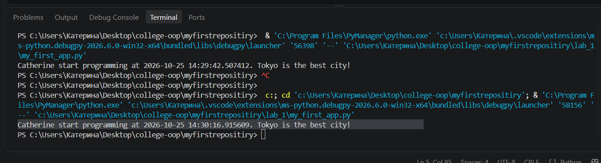
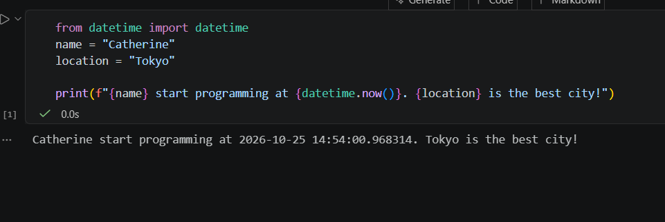
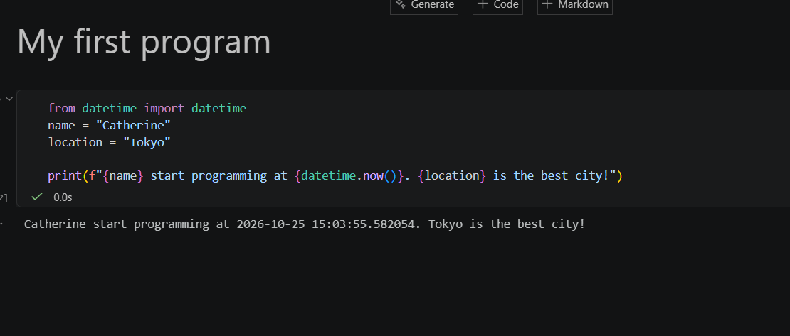
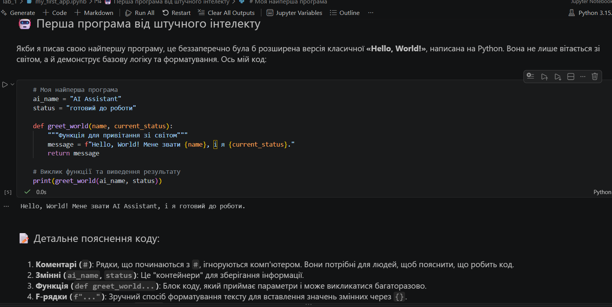

# Звіт до роботи

**Тема:** [Вступні заняття: налаштування середовища, початок роботи з Python та Markdown.]

**Мета роботи:** [налаштувати середовище роботи у VS Code, створити репозиторій GitHub та налаштувати інтеграцію з ним, написати першу програму на Python і створити звіт із використанням форматування Markdown.]

## Виконання роботи

1. ### Результати виконання завдання 1 (Встановлення плагінів)
1. Встановили розширення Python, Jupyter та Copilot із вкладки Extensions у VS Code.
2. Перезавантажили VS Code та переконалися, що підсвічування синтаксису Python працює коректно, а AI-помічник Copilot успішно надає підказки.
3. Навчились налаштовувати робоче середовище для розробки мовою Python.

### Результати виконання завдання 2 (Перша програма на Python)
1. Створили робочу папку та файл `my_first_app.py`.
2. Написали код програми, змінивши змінні `name` на "Kateryna" та `location` на "Lviv".
3. Програма вивела значення: `Kateryna start programming at 2026-10-25 15:30:45.321654. Lviv is the best city!`
4. Протестували різні способи запуску коду (через кнопку "Run Python File" та через термінал).

### Результати виконання завдання 3 (Робота з Jupyter Notebook)
1. Створили файл `my_first_app.ipynb` та скопіювали туди вихідний код.
2. Програма вивела ідентичний результат безпосередньо під коміркою з кодом.
3. Створили комірку формату Markdown, де додали заголовок `# Моя перша програма` та опис.
4. Навчились працювати з інтерактивними ноутбуками, поєднуючи виконання коду з форматованим текстом.

### Результати виконання завдання 4 (Робота з AI/Copilot)
1. Запитали у Copilot, яку першу програму він би написав. 
2. Отримали варіант розширеної версії "Hello, World!" з використанням функцій та f-рядків, а також детальне пояснення до неї.
3. Протестували запропоновану програму у своєму середовищі — вона успішно виконалась без помилок.

### Вставлені рисунки

*Нижче наведені скріншоти виконання програми та налаштованого середовища:*

- **Результат виконання у файлі my_first_app.py:**
  

- **Результат виконання та вигляд Markdown у файлі my_first_app.ipynb:**
  

  **Результат виконання та вигляд Jupyter Notebok з заголовком у файлі my_first_app.ipynb:**
  

  **Результат виконання та вигляд AI/Copilot program в Jupyter Notebok у файлі my_first_app.ipynb:**
  


### Вставлений код

**Код моєї першої програми:**
```python
from datetime import datetime
name = "Catherine"
location = "Tokyo"
print(f"{name} start programming at {datetime.now()}. {location} is the best city!")
```

**Код AI program:**
  # Моя найперша програма
ai_name = "AI Assistant"
status = "готовий до роботи"

def greet_world(name, current_status):
    """Функція для привітання зі світом"""
    message = f"Hello, World! Мене звати {name}, і я {current_status}."
    return message

# Виклик функції та виведення результату
print(greet_world(ai_name, status))

## Висновок

- ❓ **Що зроблено в роботі:** Встановлено та налаштовано середовище VS Code з розширеннями Python, Jupyter та Copilot. Написано, виконано та задокументовано першу програму на Python у форматах `.py` та `.ipynb`. Усі результати збережено та завантажено у репозиторій на GitHub.
- ❓ **Чи досягнуто мети роботи:** Так, мету роботи повністю досягнуто. Робоче середовище налаштоване та готове до подальшого використання.
- ❓ **Які нові знання отримано:** Здобуто практичні навички роботи з Jupyter Notebook, використання синтаксису Markdown для оформлення звітів, інтеграції AI Copilot для генерування коду та базової роботи з Git/GitHub через інтерфейс VS Code.
- ❓ **Чи вдалось відповісти на всі питання задані в ході роботи:** Так, на всі поставлені питання отримано вичерпні відповіді під час виконання завдань.
- ❓ **Чи вдалося виконати всі завдання:** Так, усі завдання з інструкції виконано в повному обсязі.
- ❓ **Чи виникли складності у виконанні завдання:** Суттєвих складнощів не виникло. Проблему з порожнім файлом зображення було швидко виявлено та виправлено шляхом правильної вставки скріншота з буфера обміну.
- ❓ **Чи подобається такий формат здачі роботи (Feedback):** Так, формат здачі через Markdown-звіт на GitHub є дуже зручним, оскільки дозволяє тримати код, текстові пояснення та візуальні результати (скріншоти) в одному структурованому документі.
- ❓ **Побажання для покращення (Suggestions):** Поточний формат подачі матеріалу зрозумілий та ефективний. У майбутньому було б цікаво вирішувати ще більше алгоритмічних задач на Python із залученням Copilot.